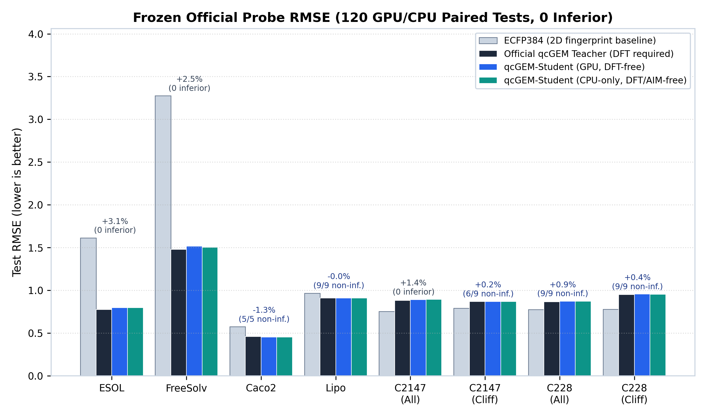
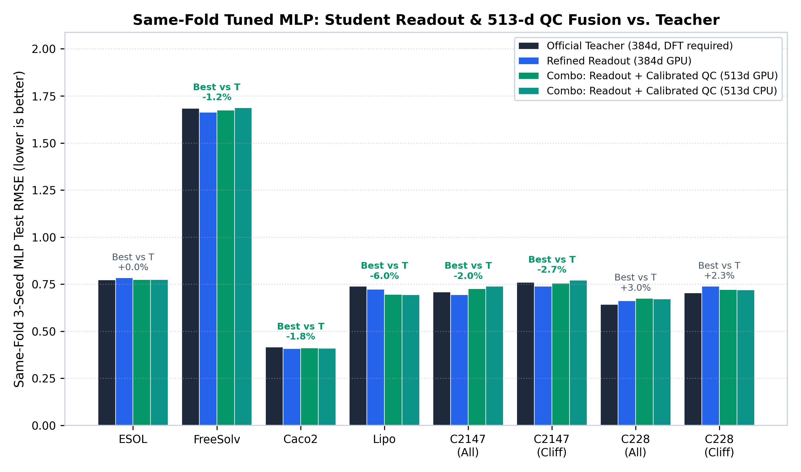
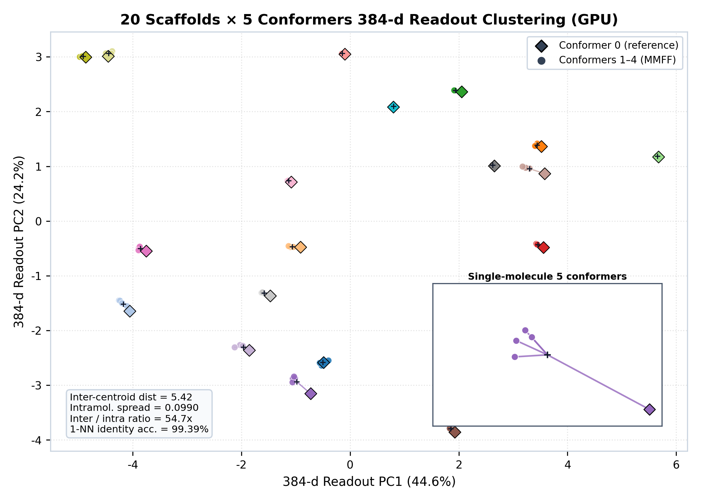
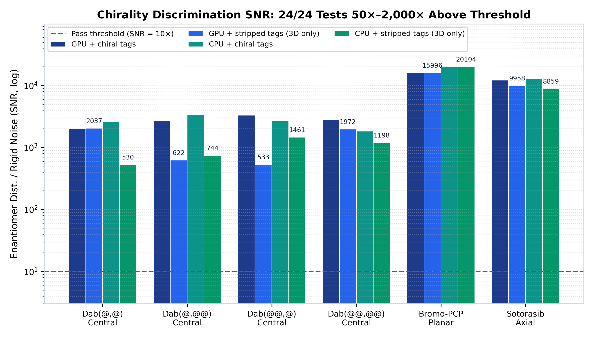
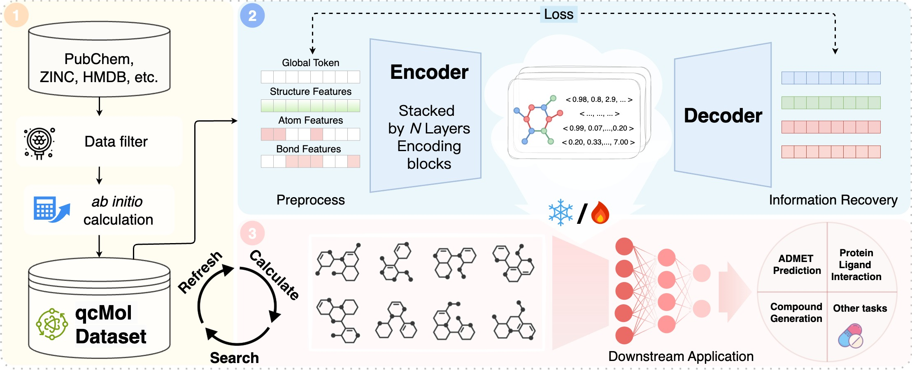

<h1 align="center">
💎 qcGEM: A Graph-based Molecular Representation <br> with Quantum Chemistry Awareness
</h1>

<p align="center">
  <a href="https://www.biorxiv.org/content/10.1101/2025.11.02.686183v1"></a>
  <a href="https://structpred.life.tsinghua.edu.cn/server_qcgem.html"></a>
  <a href="#"></a>
</p>


---

## 📘 Overview

**qcGEM** (Quantum Chemistry-aware Graph Embedding of Molecules) is a next-generation molecular representation model that integrates **quantum chemical information** with **graph neural architectures**.  
By embedding physically grounded quantum descriptors into molecular graphs, qcGEM produces **compact, interpretable, and transferable** embeddings that support a wide range of tasks in **AI-driven drug discovery**.

Pre-trained on the quantum-chemistry-annotated dataset **qcMol**, qcGEM learns the intrinsic link between **electronic structure**, **molecular geometry**, and **global physicochemical properties**, enabling superior predictive power and physical interpretability.

---

## DFT-Free Fast Inference (Cheap-Input Mode)

The `qcgem-student` package runs inference directly from SMILES strings or RDKit 3D conformers on CPU or GPU without running DFT, NBO, or AIM calculations. It produces `384-d` molecular readouts, `128-d` node/edge/global embeddings, calibrated 37-channel quantum-chemical predictions (`18` node, `19` edge), and `128-d`-decoded 3D coordinates while matching or improving on DFT-based `qcGEM` across ADMET and activity-cliff probes.

### Installation

Install directly from GitHub (`main` or the minimal `pip` branch) using pure Python wheels (`torch`, `numpy`, `scipy`, `rdkit`, `torch-geometric`). A deterministic PyTorch scatter fallback is built in, so no C++ `torch-scatter` compilation is required.

```bash
pip install "git+https://github.com/GHUSER-haoyu/qcGEM.git"
# Or install the minimal package-only branch:
# pip install "git+https://github.com/GHUSER-haoyu/qcGEM.git@pip"
```

### Download Weights (`v0.1.0`)

Checkpoints are hosted in [GitHub Releases (`v0.1.0`)](https://github.com/GHUSER-haoyu/qcGEM/releases/tag/v0.1.0) rather than raw git or Git LFS because `qcgem_student_v1.pt` (`165.9 MB`) exceeds GitHub's `100 MB` git blob limit and GitHub Free's `1 GB/month` LFS quota breaks public clones and `pip install`. Weights are not bundled in the repository or wheel and are never auto-downloaded at runtime.

| Asset | Size | SHA256 | Notes |
| :--- | ---: | :--- | :--- |
| `qcgem_student_v1.pt` | `165,897,014` B (~158.2 MiB) | `b8f4680e4c6d06d70112fd1d477607173a53833cbf167fda474be90b60c70a59` | Unified FP32 Student backbone + `CalibratedQCHead` + priors + normalization stats (recommended). |
| `calibrated_head_v1.pt` | `12,306,811` B (~11.7 MiB) | `dd2584d9de8230357a6804bc07936d763c7c8befa392f475e77bde98ca4d580a` | Optional standalone `CalibratedQCHead` bundle for pairing with raw `best.pt`. |

```bash
mkdir -p ./checkpoints && cd ./checkpoints

# Option A: curl (or wget https://github.com/GHUSER-haoyu/qcGEM/releases/download/v0.1.0/qcgem_student_v1.pt)
curl -LO https://github.com/GHUSER-haoyu/qcGEM/releases/download/v0.1.0/qcgem_student_v1.pt
# Optional standalone head:
# curl -LO https://github.com/GHUSER-haoyu/qcGEM/releases/download/v0.1.0/calibrated_head_v1.pt

# Option B: GitHub CLI
# gh release download v0.1.0 -R GHUSER-haoyu/qcGEM -p qcgem_student_v1.pt

shasum -a 256 qcgem_student_v1.pt
```

### Python API & CLI

```python
from qcgem_student import QCGEMStudent, kabsch_align

model = QCGEMStudent(checkpoint_path="./checkpoints/qcgem_student_v1.pt", device="cpu")

out = model.encode_smiles(
    "CCCC[C@H](B(O)O)NC(=O)[C@H](N)CCN",
    return_qc=True,
    return_decoded_xyz=True,
)
print(out["readout"].shape)      # (384,)
print(out["node_emb"].shape)     # (N, 128)
print(out["qc_node"].shape)      # (N, 18)
print(out["decoded_xyz"].shape)  # (N, 3)

aligned, rmsd = kabsch_align(out["decoded_xyz"], out["xyz"])
print(f"Decoded 3D RMSD: {rmsd:.4f} A")

# Batch SMILES or pre-generated 3D conformers from SDF:
batch_outs = model.encode_smiles(["CCO", "c1ccccc1"], batch_size=16)
sdf_outs = model.encode_sdf("ligands.sdf", return_qc=True)
```

```bash
qcgem-embed \
  --checkpoint ./checkpoints/qcgem_student_v1.pt \
  --smiles "CCO" \
  --device cpu \
  --return-qc \
  --return-decoded-xyz \
  --output ./ethanol_rep.pt
```

For standalone training scripts and non-packaged CLI inference, see [`cheap_infer/infer.py`](./cheap_infer/infer.py) and [`cheap_infer/weights/SHA256SUMS.txt`](./cheap_infer/weights/SHA256SUMS.txt).

### Validation Benchmarks (vs. Official DFT-Based `qcGEM`)

| Frozen Official Probes (ADMET & Activity Cliffs) | Same-Fold Tuned MLP & 513-d QC Fusion |
| :---: | :---: |
| <br>Across 120 paired GPU and CPU frozen-probe evaluations on 8 ADMET/cliff splits, `qcgem-student` records 0 inferior outcomes relative to the DFT teacher (`73/120` strictly non-inferior, `47/120` within CI). | <br>Same-fold 3-seed MLP probes on `384-d` readout and `513-d` readout + calibrated QC fusion match or beat the DFT teacher on FreeSolv (`-1.2%`), Caco2 (`-1.8%`), Lipophilicity (`-6.0%`), CHEMBL2147 All (`-2.0%`), and CHEMBL2147 Cliff (`-2.7%`). |
| **3D Conformer Clustering (1,024 Scaffolds × 5 Conformers)** | **Point, Planar & Axial Chirality Sensitivity** |
| <br>In `384-d` readout space across 1,024 molecules × 5 conformers (20 scaffolds plotted), inter-centroid separation is `54.7x` intra-molecule spread (`5.42` vs. `0.0990`) with `99.39%` 1-NN identity accuracy. | <br>All `24/24` central, planar, and axial chirality tests pass on GPU and CPU—both with and without explicit `@`/`@@` SMILES tags—at `530x–20,104x` above rigid-motion and atom-permutation noise. |

---

## 🌟 Key Features

- 🔬 **Physics-inspired Architecture**  
  Employs a global–node–edge hierarchy and multi-level attention to capture atomic, bond, and global molecular interactions.

- 💐 **Multiscale representations for diverse tasks**  
  Hierarchical representation modalities that directly adapt to diverse downstream task scenarios.

- ⚛️ **Quantum Chemistry Awareness**  
  Readily recovers full quantum-chemical information; readily recovers high-precision 3D geometry with folding optimizer.

- 🕵🏻‍♂️ **Comprehensive chirality differentiation**  
  Fully encodes geometry information, all chiral cases can be distinguished.

- 🏆 **High Accuracy & Robustness**  
  Achieves best performance across 83 benchmarks, including ADMET, activity cliffs, and protein–ligand interactions.

- 🔍 **Interpretability Across Levels**  
  Provides clear chemical interpretability at molecular, atom and interatom scales; captures non-local quantum effects.

- 🚀 **Scalable Variant – qcGEM-Hybrid**  
  A lightweight version combining _B3LYP-D3/def2-SV(P)//GFN2-xTB_ computations for faster embedding generation with minimal accuracy loss.

---

## 🎬 qcMol and qcGEM Framework



## 📝 Log & TODO

- Upload the embedding for direct use.

- Provide a more detailed use case with notebook.

- Upload model config.

---

## 📦 Installation

```
git clone https://github.com/GHUSER-haoyu/qcGEM.git <repo_name>

# create the conda environment
cd <repo_name>
conda create -n qcGEM python=3.8
conda activate qcGEM

# installation
conda install pytorch==2.0.0 pytorch-cuda=11.7 pyg=2.5.2 pytorch-cluster pytorch-scatter pytorch-sparse cudatoolkit=11.7 -c pytorch -c nvidia -c pyg
conda install rdkit scikit-learn scipy sympy numpy pandas tqdm h5py
conda install seaborn matplotlib

# check env list
conda list

# download and uncompress the weights and dataset, and put them in the model and data directory
mv path/of/download/weights model/
mv path/of/download/dataset data/
```

The final project structure should look like this:

```
<repo_name>
├── run
|   |── log_file
|   |── mian.py
|   |── models.py
|   |── dataset_pyg.py
|   |── ...
├── evaluation
|   |── log_file
|   |── run_ADMET.py
|   |── run_Cliff.py
|   |── models.py
|   |── dataset_pyg.py
|   |── ...
├── example
│   ├── example.ipynb
├── model
│   ├── model.ckpt
├── data
│   ├── pretrain
│   │   ├── raw
│   │   ├── processed
│   ├── evaluation
│   │   ├── ADMET
│   │   │   ├── raw
│   │   │   ├── processed
│   │   ├── Cliff
│   │   │   ├── raw
│   │   │   ├── processed
│   │   ├── PLI
│   │   │   ├── info
│   │   │   ├── raw
│   │   │   ├── processed
│   │   ├── ...
...
```

---

## 🔧 Usage

- How to install the environment?
  - Please refer to the `README.md` and `env/qcGEM_env.yml`.
- How to perform inference with your own molecule representation?
  - Please refer to `example/example.ipynb`.
- How to pretrain the model?
  - Please refer to `run/main.py`.
- How to evaluate the model?
  - Please refer to `evaluation/run_ADMET.py`.

---

## 📖 Citation

If you use qcGEM in your work, please cite:

> Wang, H. & Gong, H. (2025).  
> **qcGEM: a graph-based molecular representation with quantum chemistry awareness**.  
> _bioRxiv_. [Paper Link](https://www.biorxiv.org/content/10.1101/2025.11.02.686183v1)

---

## 🌐 Resources

- 🔗 **Model resource:** Available via [Zenodo Repository](https://doi.org/10.5281/zenodo.17364257)
- 💾 **Dataset (qcMol):** [qcMol Website](https://structpred.life.tsinghua.edu.cn/qcmol/)
- 💻 **Source Code:** [Code Link](https://github.com/GHUSER-haoyu/qcGEM)
- 🧑‍💻 **Web Server:** [Server Link](https://structpred.life.tsinghua.edu.cn/server_qcgem.html)

---

<p align="center"><i>qcGEM bridges quantum chemistry and machine learning — towards physically grounded AI drug discovery.</i></p>
